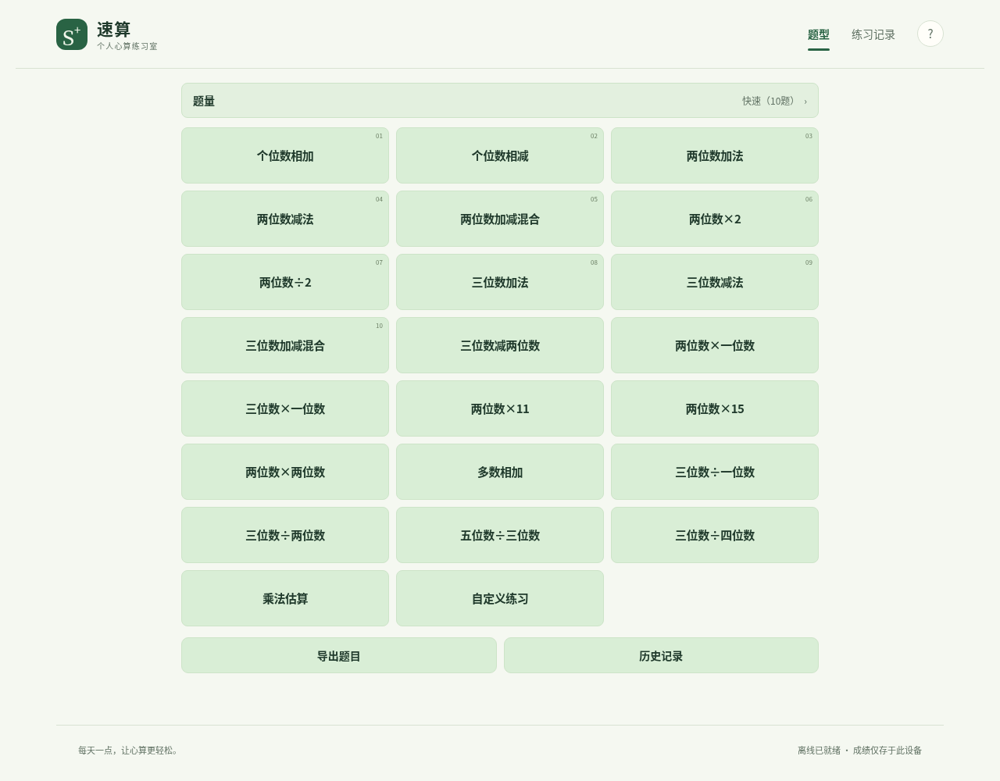

# 速算 · 个人心算练习室

一个免费、无广告、无需账号的静态速算网站。支持手机、平板、电脑、离线练习和本地成绩复盘。代码不依赖第三方前端库、API或数据库。

**开发状态：v1.1.1：十组核心、十二种扩展与自定义已实现，首页为三列紧凑格子。部署状态见 [实施报告](docs/IMPLEMENTATION_REPORT.md)。**



## 可以练什么

| 组别 | 题型 | 规则 |
|---|---|---|
| 1 | 个位数相加 | 直接点入口，逐张看10个数字，最后填写总和 |
| 2 | 个位数相减 | 动态起始数≤99，再看10个减数；高借位率、结果始终为正 |
| 3 | 两位数加法 | 每题个位强制进位，十几+十几≤30% |
| 4 | 两位数减法 | 每题个位强制借位，差值>0 |
| 5 | 两位数加减混合 | 保持进/借位约束，混排；加法子题的简单题≤30% |
| 6 | 两位数×2 | 不计时、不评级 |
| 7 | 两位数÷2 | 不计时、不评级；允许奇数，用小数（如18.5）作答 |
| 8～10 | 三位数加、减、混合 | 每题两个三位数；分别使用已核实的计时参考 |

另有十二种扩展练习，以及自定义加、减、乘题目。本轮补齐多数相加（四个两位数）、三位÷一位、三位÷两位、五位÷三位、三位÷四位百分数及乘法估算。普通除法答案四舍五入到两位小数；估算允许相对误差±5%，百分数允许相对误差±3%（例如6%填6，接受5.82～6.18）。除闪卡外，支持10/15/自定义5～100题。触屏数字键盘和实体键盘均可操作，`Enter`提交、`Backspace`退格。

训练结束后，闪卡展示有序数字回顾；算式练习展示汇总弹窗和逐题答案、对错、用时。正确率与速度参考分开，不擅自规定错题对等级的影响。第6、7组从训练到历史记录均不记录或显示用时。

## 本地运行

需要 Node.js 22.7+。没有运行或构建依赖，**无需 `npm install`**。

```bash
npm test
npm run dev
```

打开终端显示的地址，默认 <http://localhost:4173/susuan-trainer/>。不要直接双击HTML文件；浏览器模块、计时资料和离线服务需要HTTP服务。

```bash
npm run build
npm run preview
```

`dist/` 是可部署产物。构建仅复制网页资产，**不包含参考截图、文档、测试记录或开发缓存**。站点兼容仓库子路径，没有写死域名。

首页所有入口按每行三个格子排列。“本次练习”选择框包含全部23项（含个位数加减），与格子同步并记住上次选择；首次默认第1组。改变题型时保留已填的有效自定义题量。

## 离线与隐私

首次联网打开并看到页脚“离线已就绪”后，可在离线状态继续练习。在 iPhone / iPad Safari 中使用“分享 → 添加到主屏幕”。缓存升级在下次重新打开时生效，避免切换正在进行的题组。

最近100组成绩、设置和最近自定义规则仅保存在当前浏览器。可从“练习记录”导出JSON，从首页导出带答案的新题。不同设备不自动同步；清除浏览器数据会删除记录，存储不可用时仍能练习并手动导出。

## 验证

```bash
npm test                         # 26项算法/判分/状态/存储测试
npm run build
npm run preview                  # 另开终端运行以下命令
python tests/browser_test.py     # 需要Playwright和浏览器，参见实施报告
```

- 第3～5组各20,160道采样，覆盖5～100的每种题量。
- 第1组2,000组，第2组1,000组，逐步验算数字、结果和借位。
- 浏览器证据：[手机首页](docs/evidence/phone-home.png)、[平板首页](docs/evidence/tablet-home.png)、[第7组不计时](docs/evidence/group-7-untimed.png)、[第10组计时](docs/evidence/group-10-timing.png)。
- [闪卡真实点击回放记录](docs/evidence/flash-click-replay.json)、[浏览器结果](docs/evidence/browser-results.json)、[逐项验收](docs/ACCEPTANCE_TESTS.md)。所有截图成绩均为隔离测试产生的示例数据。

## 部署与维护

当前按用户v2.4授权，发布到现有公开仓库 `ayden96718-rgb/notion-countdown` 的 `susuan-trainer/` 子目录，完整源码资料保存在其 `project/` 中。保留原倒计时首页和Pages设置；只新增此文件夹。实际链接与状态见 [实施报告](docs/IMPLEMENTATION_REPORT.md)。

当前子目录通过现有 `main` 分支根目录Pages发布；本项目附带的工作流是未来独立仓库的备选模板，在嵌套的 `project/.github/` 中不会执行。更新子目录包使用 `node scripts/manifest.mjs`、`node scripts/prepare-pages-folder.mjs`。参见 [部署步骤](docs/DEPLOYMENT.md)。

后续维护先读 [AGENTS.md](AGENTS.md)、[唯一权威需求 v2.6](docs/requirements.md) 和 [计时依据](data/timing-reference.json)。交接原文、27张参考截图和索引保留在 `docs/`，只作需求证据，未用于网站视觉资产。

本轮按用户要求不增加凑整百、独立混合形态、键盘排列切换、手写笔、N-back等其他功能。错题综合评级仍待确认；正确率与速度参考分别显示。完整边界见实施报告。
